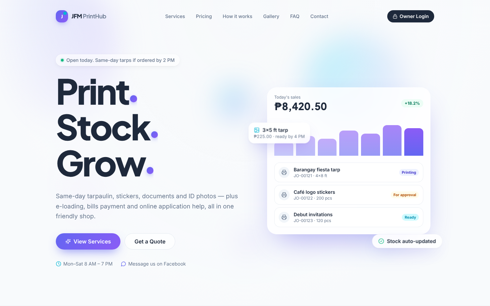
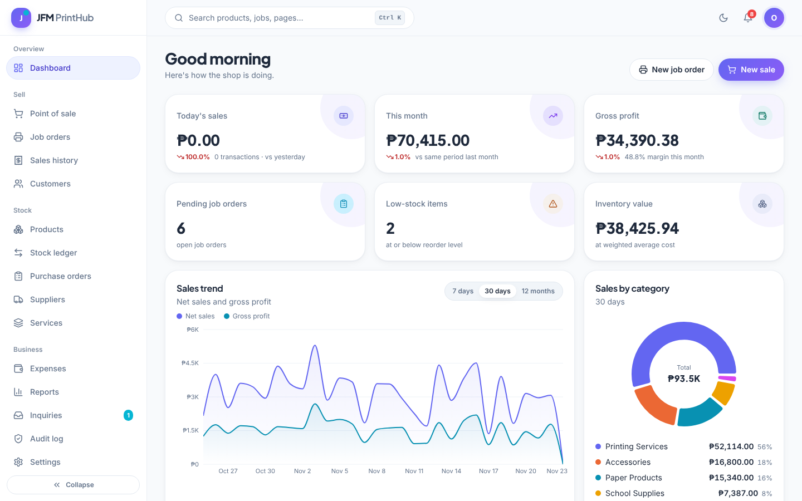
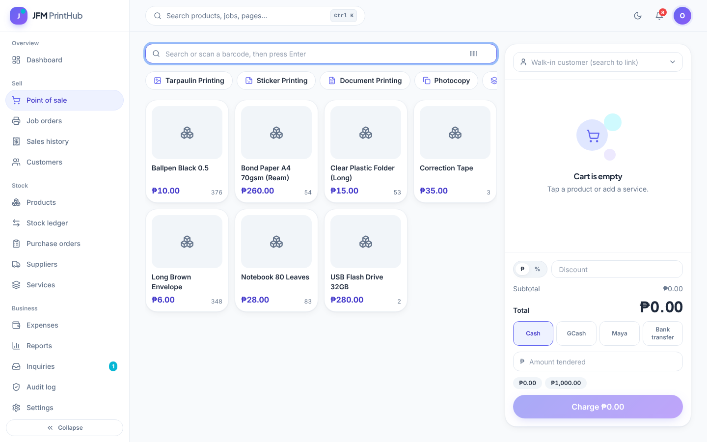
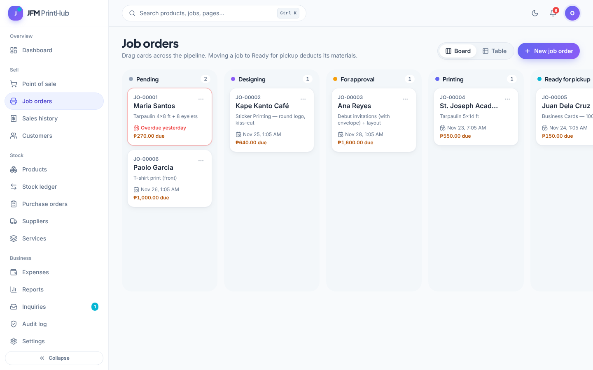
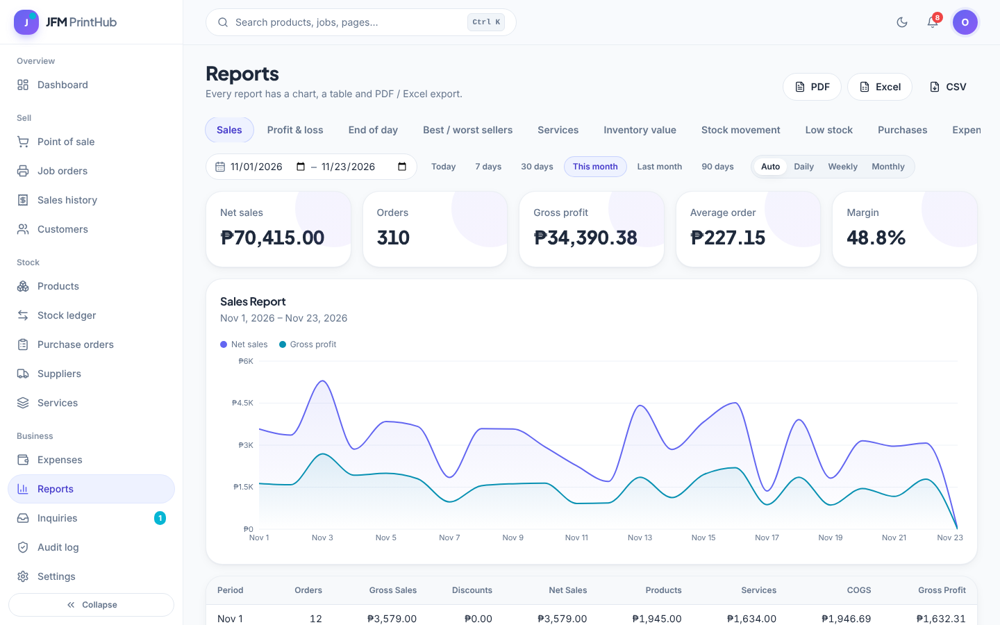
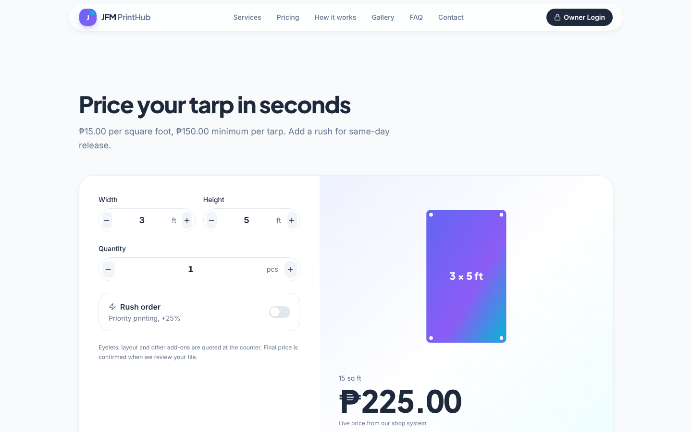
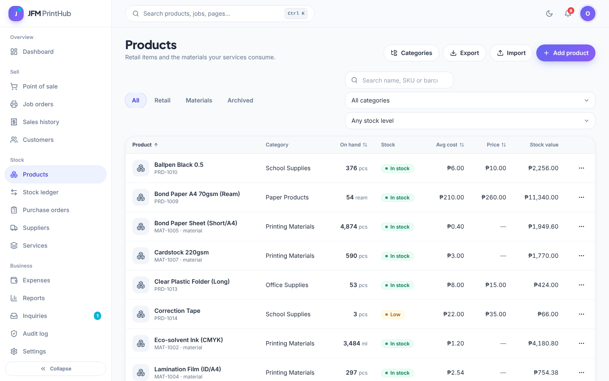

# JFM PrintHub

Inventory, sales and print-services management for a small Filipino printing and online-services shop. It covers tarpaulin and sticker printing, documents, photocopy, lamination, ID photos and e-loading, plus retail school and office supplies.

The app has two parts:

- **Public site** (`/`): an animated landing page with live tarp pricing, gallery, FAQ and a contact form.
- **Owner dashboard** (`/app`): POS, job orders (Kanban), inventory ledger, purchasing, expenses, reports, notifications, audit log and a website-content editor. Only one person, the owner, can sign in.



---

## Screenshots

| | |
|---|---|
|  |  |
| **Dashboard**: KPIs, sales trend, category mix, payment split, due jobs, low stock | **POS**: search or scan, price services, discount, cash/GCash/Maya/bank, change, receipt |
|  |  |
| **Job orders**: drag through the pipeline; Ready for pickup deducts materials | **Reports**: 10 reports, each with a chart, a table and PDF/Excel/CSV export |
|  |  |
| **Tarp estimator**: draws the tarp to scale and prices it with the same backend engine as the POS | **Products**: retail items and materials with stock badges, import/export |

Mobile: [landing](docs/screenshots/mobile-landing.png) · [dashboard](docs/screenshots/mobile-dashboard.png)

---

## Tech stack

| Layer | Stack |
|---|---|
| Frontend | React 18, Vite, React Router 6, TanStack Query, Zustand, Tailwind CSS, Framer Motion, Recharts, React Hook Form + Zod, Lucide, react-hot-toast, date-fns |
| Backend | Spring Boot 3.3, Java 21, Spring Web/Data JPA/Validation/Security (OAuth2 resource server), Flyway, Lombok, MapStruct, springdoc-openapi, OpenPDF, Apache POI, Commons CSV |
| Data / auth / files | Supabase Postgres (JDBC through the pooler), Supabase Auth (email + password), Supabase Storage (signed URLs) |
| Tests | JUnit 5 + Mockito unit tests, plus a Testcontainers Postgres integration test |

## Repository layout

```
jfm-printhub/
├─ backend/                 Spring Boot API (Maven)
│  ├─ src/main/java/com/jfmprinthub/
│  │   config/ security/ common/          cross-cutting
│  │   product/ category/ supplier/ customer/ stock/ purchase/
│  │   service/ joborder/ sale/ expense/ report/ dashboard/
│  │   inquiry/ notification/ audit/ settings/ publicsite/ storage/
│  ├─ src/main/resources/db/migration     Flyway schema + defaults (all envs)
│  ├─ src/main/resources/db/seed          60-day sample data (dev profile only)
│  └─ Dockerfile
├─ frontend/                React app (Vite)
│  └─ src/ app/ pages/ components/{ui,layout,charts,landing,shared}/ features/ lib/ stores/ styles/
├─ supabase/storage-setup.sql   creates the 3 storage buckets
├─ render.yaml              Render blueprint for the API
└─ docs/screenshots/
```

---

## How it works (key design decisions)

**Single owner.** There is no sign-up page or endpoint. You create the owner in Supabase Auth by hand. The backend checks the Supabase JWT (JWKS for ES256/RS256 projects, or HS256 with the legacy secret, plus issuer and audience) and returns **403** for any `sub` other than `APP_OWNER_ID`. After password login, the frontend also calls the API and signs out any account that is not the owner.

**The stock ledger is the source of truth.** Every quantity change is a row in `stock_movements`, with a type, reason, signed quantity, unit cost, running balance and reference (sale, PO or job number).

- `StockService` is the only code allowed to change stock.
- It locks product rows in id order with `SELECT … FOR UPDATE` to avoid deadlocks.
- It enforces the negative-stock policy and recalculates the weighted average cost on every stock-in.
- It always runs inside the caller's transaction, so a sale, a PO receipt or a job's material consumption either fully succeeds or leaves no trace.
- `v_product_stock` recomputes balances from the ledger. The Stock ledger page shows a reconciliation banner, which should always read "All product balances match".

**One pricing engine.** `PricingService` handles the FIXED, PER_SQFT, PER_PIECE (batches) and PER_PAGE (B&W/color, long-paper surcharge) models, plus minimum charges, add-ons (fixed, %, per unit, per piece) and rush fees. All three places that show a price call it:

- the landing page estimator, through `POST /api/public/quote` (which hides costs)
- the POS
- job orders

A 3×5 ft tarp is therefore priced identically everywhere.

**Bill of materials.** Each service lists the materials it consumes per billable unit; for example, 1 sq ft of tarpaulin uses 1 sq ft of tarp material and 3 ml of ink.

- A job order consumes its materials once, when it is marked printed or moved to Ready for pickup. Material cost is recorded per line.
- Walk-in service sales at the POS consume materials at checkout.
- Gross profit uses these real costs.

**Job order → sale.** Claiming a job requires the balance to be fully paid. Claiming creates a `JOB_ORDER` sale and links the down and balance payments to it. Voiding that sale reopens the job.

**Voids reverse stock.** Voiding a POS sale posts `SALE_VOID` stock-in movements at the original unit cost.

**Time zone.** Everything is stored in UTC. Business-day reporting and cash closing use Asia/Manila. Money is `NUMERIC(12,2)`, quantities `NUMERIC(12,3)`, and amounts display as `₱1,234.50`.

**Row-level security.** Flyway enables RLS on every table with no policies. The browser's anon key can only be used for Auth and signed Storage uploads; only the backend's DB role can read data.

---

## Local setup

### Prerequisites
- Java 21 and Maven 3.9+
- Node 20+
- A Supabase project (free tier is fine), or any Postgres 15+ plus a Supabase project for Auth

### 1. Supabase
1. **Auth → Users → Add user.** Create the owner (email + password), then copy the user's **UID**.
2. **SQL editor:** run [`supabase/storage-setup.sql`](supabase/storage-setup.sql) to create the three buckets.
3. **Project Settings → Database:** copy the **Session pooler** connection string (port 5432).
4. **Project Settings → API:** copy the project URL, the anon key and the service_role key. If the project uses legacy JWT signing, also copy the JWT secret.
5. **Auth → URL configuration:** add `http://localhost:5173/reset-password` (and your production URL) to the redirect URLs so "Forgot password" works.

### 2. Backend
```bash
cd backend
cp .env.example .env        # fill in the values from step 1
export $(grep -v '^#' .env | xargs)
mvn spring-boot:run         # dev profile: runs Flyway + loads 60 days of sample data
```
- API: http://localhost:8080
- Swagger UI: http://localhost:8080/swagger-ui.html (click **Authorize** and paste an access token)
- Health: http://localhost:8080/actuator/health

> The `dev` profile loads `db/seed` (sample products, services with BOMs, suppliers, POs, job orders, expenses, inquiries and about 60 days of sales). The `prod` profile loads only the schema and default content.

### 3. Frontend
```bash
cd frontend
cp .env.example .env        # VITE_SUPABASE_URL, VITE_SUPABASE_ANON_KEY, VITE_API_BASE_URL
npm install
npm run dev                 # http://localhost:5173
```
Sign in at `/login` with the owner account.

### Tests
```bash
cd backend
mvn test
```
- `StockServiceTest`: weighted average cost, negative-stock policy, sign validation, lock ordering
- `PricingServiceTest`: per-sq-ft with minimum charge, add-ons and rush, per-page color/long paper, per-piece batches, BOM scaling
- `PurchaseOrderReceivingTest`: partial and full receiving, invoice cost, over-receipt rejection, closing short
- `InventoryFlowIntegrationTest` (Testcontainers Postgres, skipped automatically when Docker isn't running): migrations + seed reconcile, an oversell rolls back the whole sale, checkout → void restores stock

---

## Environment variables

| Backend | Purpose |
|---|---|
| `SPRING_PROFILES_ACTIVE` | `dev` (seed data) or `prod` |
| `DB_URL`, `DB_USERNAME`, `DB_PASSWORD` | Supabase pooler JDBC URL and credentials |
| `SUPABASE_URL` | e.g. `https://abcd.supabase.co` (the JWT issuer is derived from it) |
| `SUPABASE_JWKS_URL` | Optional; defaults to `<SUPABASE_URL>/auth/v1/.well-known/jwks.json` |
| `SUPABASE_JWT_SECRET` | Set **only** for legacy HS256 projects |
| `SUPABASE_SERVICE_ROLE_KEY` | Signs Storage URLs; stays server-side |
| `APP_OWNER_ID`, `APP_OWNER_EMAIL` | The single owner |
| `CORS_ALLOWED_ORIGINS` | Comma-separated frontend origins |

| Frontend | Purpose |
|---|---|
| `VITE_SUPABASE_URL`, `VITE_SUPABASE_ANON_KEY` | Auth + signed uploads |
| `VITE_API_BASE_URL` | Spring Boot base URL (no trailing slash) |

---

## API overview

| Area | Endpoints (all under `/api/v1`, owner JWT required) |
|---|---|
| Products | `GET/POST /products`, `GET/PUT/DELETE /products/{id}`, `POST /products/{id}/restore`, `GET /products/options`, `/barcode/{code}`, `/low-stock`, `/{id}/movements`, `POST /products/import` (CSV), `GET /products/export?format=XLSX\|CSV\|PDF` |
| Stock | `GET /stock/movements`, `POST /stock/in`, `POST /stock/out`, `POST /stock/count`, `GET /stock/reconciliation` |
| Purchasing | `/suppliers`, `/purchase-orders` (+ `/order`, `/receive`, `/cancel`, `/payments`, `/pdf`, `/summary`, `GET/POST /suggestions`) |
| Services | `/services`, `POST /services/quote` |
| Job orders | `/job-orders`, `/board`, `PATCH /{id}/status`, `/mark-printed`, `/payments`, `/claim`, `/cancel`, `/files`, `/ticket.pdf` |
| Sales | `POST /sales` (checkout), `GET /sales`, `/{id}`, `/{id}/void`, `/{id}/receipt.pdf?width=58\|80` |
| Other | `/customers`, `/expenses`, `/expense-categories`, `/reports/{type}` (+ `/export`), `/dashboard`, `/notifications`, `/inquiries`, `/audit-logs`, `/settings`, `/site-content/{key}`, `/storage/upload-url`, `/backup/export` |
| Public | `GET /api/public/site`, `/services`, `/gallery`; `POST /api/public/quote` (60/min/IP), `POST /api/public/inquiries` (5/hour/IP, honeypot) |

Errors always use the same JSON shape: `{ timestamp, status, error, code, message, path, fieldErrors[] }`.

---

## Deployment

| Piece | Where | Notes |
|---|---|---|
| Database / Auth / Storage | **Supabase** | Run `storage-setup.sql`. The backend applies Flyway on boot. |
| API | **Render**, Railway or Fly.io | `backend/Dockerfile`; `render.yaml` included. Set `SPRING_PROFILES_ACTIVE=prod` and every variable above. Health check: `/actuator/health`. Swagger is off in prod unless `SWAGGER_ENABLED=true`. |
| Frontend | **Vercel** or Netlify | Root `frontend/`, build `npm run build`, output `dist`. `vercel.json` / `netlify.toml` add the SPA rewrite and immutable asset caching. |

After deploying:
- Add the frontend URL to `CORS_ALLOWED_ORIGINS`.
- Add `<frontend>/reset-password` to Supabase Auth redirect URLs.

> Free-tier API hosts sleep when idle. The landing page renders immediately from bundled default content and replaces it with live content when the API wakes up.

## Performance & accessibility notes

- **Code splitting:** every route is code-split. The landing page loads only React and Framer Motion; Supabase (≈60 kB gz) and Recharts (≈115 kB gz) load only for login and dashboard routes.
- **Fonts:** self-hosted variable fonts (Plus Jakarta Sans, Inter), with no third-party requests.
- **Motion:** transform-only, and `MotionConfig reducedMotion="user"` plus a CSS `prefers-reduced-motion` override turn animation off for users who ask.
- **Charts:** the categorical palette is validated for color-vision-deficiency separation in light and dark mode. Every multi-series chart has a legend, and the donuts list values next to their colors.
- **Accessibility:** keyboard focus rings, a skip link, ARIA on dialogs, switches, tabs and comboboxes, Escape-to-close and focus trapping in modals, and a status menu on Kanban cards as a keyboard alternative to drag-and-drop.

## Possible next steps
- Move rate limiting to Redis/Bucket4j if you run more than one API instance.
- Add SMS "ready for pickup" notifications (e.g. Semaphore) on the `READY_FOR_PICKUP` transition.
- Add a restore tool for the CSV backup bundle.
# JFM
